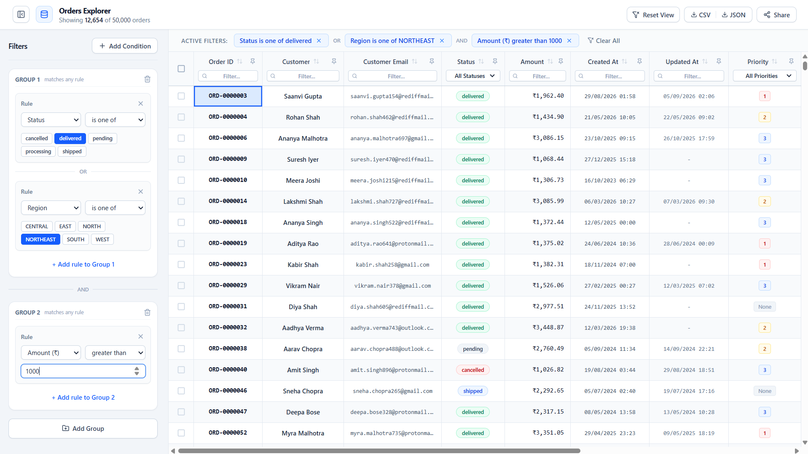
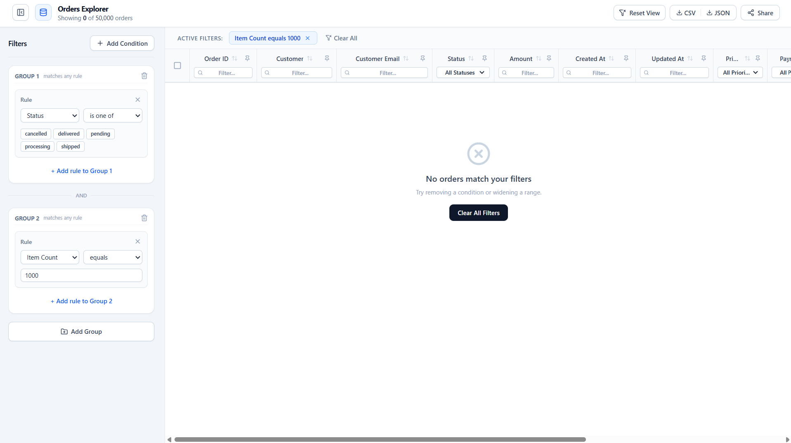

# Orders Explorer

One screen for browsing ~50,000 orders: a data grid and a filter builder, both built from scratch (no grid, virtualization or query-builder library).

## How to run

Needs **Node 24** (see `.nvmrc`) and **pnpm**.

```bash
git clone https://github.com/gautam-ch/merkle-Gautam.git
cd merkle-Gautam
pnpm install
pnpm dev
```

- Open [http://localhost:5173](http://localhost:5173).
- Production build: `pnpm build` then `pnpm preview`.
- To judge speed, use the production build. The dev server is slower because React adds extra checks in development.
- Tests: `pnpm test`. Lint: `pnpm lint`.

## Screenshots

**Main screen with data**



**Empty state (filter matches zero rows)**



## Dependencies

Runtime dependencies added on top of the Vite React template:

- `lucide-react`: icons (sort arrows, pin, filter, export buttons).
- `@radix-ui/react-dialog`: accessible side panel for the order details.
- `clsx`: joins conditional class names.
- `zod`: checks each record in `orders.json` and the filter read from the URL, so bad input is skipped or falls back to the default view instead of crashing.
- `idb`: a small wrapper that makes IndexedDB (the saved copy of the orders) simple to use.

Build-time only (not shipped to the browser): Tailwind CSS for styling, Vitest for tests.

No router, state or date library. URL sync uses `window.history`, state uses React hooks, and dates are parsed by my own code.

## Data loading

- `orders.json` lives in `public/` and is downloaded with `fetch` when the app opens. It is not bundled into the JavaScript.
- **Why:** a 17 MB file inside the bundle would make the first page load slow.
- Downloading, parsing and cleaning run in a **Web Worker**, so the page doesn't freeze. A progress screen shows while it loads.
- Each record is first checked with a `zod` schema (`src/utils/rawOrder.ts`). A record that can't be read (for example, no ID) is skipped and a warning is logged. This file has none.
- All data fixes from `data-notes.md` happen in one place (`src/utils/normalize.ts` and `src/utils/deduplicate.ts`), before the data reaches the grid or the filter.
- The cleaned data is saved in **IndexedDB**, so the next visit loads without downloading again.

## The 200 rows question

- **Choice:** the export has **20 rows**: only the selected rows that are still visible after the filter.
- **Why:** the filter shows what the user is working on right now. Exporting 180 hidden rows would be a surprise.
- The screen shows **"20 of 200 selected"**, so the count always matches the export.
- The 180 hidden rows stay selected. Remove the filter and they come back.
- If no rows are selected, Export gives all rows that match the filter.

## Design changes

- **More features were added:** a collapsible filter sidebar, a pin button and sort arrow on each column, a checkbox column, a side panel for row details, and extra buttons (Reset View, JSON, Share).
- **Filter groups can hold several rules** , and filter chips can be removed one by one. Rules inside a group are combined with OR, and groups with AND.

## Known issues

- **Slow sorting in dev mode:** sorting a text column takes about 2 seconds with `pnpm dev`, because React's development build logs every render. In the production build (`pnpm build` then `pnpm preview`) it takes about 0.2 seconds.
- **Private browsing:** if IndexedDB is blocked, there is no cache and the file is downloaded on every visit.
- **Very fast scrolling** can show empty rows for a moment before new rows are drawn.
